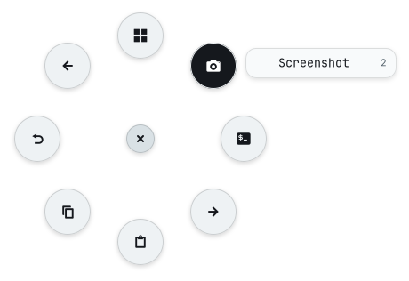
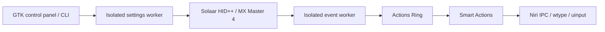

<a id="readme-top"></a>

<div align="center">

<picture>
  
</picture>

# MX4 Linux

**A native Linux control panel for Logitech MX Master 4, with haptics, Actions Ring and Smart Actions.**


[](LICENSE)


[Quick start](#quick-start) · [Usage](#usage) · [Documentation](#documentation) · [Contributing](#contributing)

</div>

<br/>

<p align="center">
  
</p>

> [!NOTE]
> **0.2.0 is unreleased and in early development.** Hardware discovery and listener cleanup have live Bolt evidence; physical setting changes, panel interaction and Bluetooth still need validation. See the [validation record](docs/validation.md).

## Overview

MX4 Linux is a GTK 4 / Libadwaita application and CLI for MX Master 4 owners on Linux. It uses Solaar's HID++ implementation to discover the mouse's capabilities and expose supported settings. Its desktop features target Niri on Wayland; no Logitech Windows or macOS executable is required.

### Features

- **Control supported mouse settings.** Adjust DPI, wheel modes and direction, SmartShift, haptic strength, panel force and built-in button assignments when reported by the device.
- **Choose from eight ring actions.** Use compact icon buttons, outward labels and a center close control. Hold the haptic panel, move and release, or select with a click or keyboard.
- **Group related actions.** Turn a position into a side menu of up to six existing routines. The editor shows a live ring preview and keeps labels and assignments together.
- **Build Smart Actions.** Combine shortcuts, application launches, text, delays and Niri commands, with optional exact application conditions.
- **Find controls quickly.** Mouse, Actions and Profiles have separate views; the wheel preview and ring respond with finite animations and respect the desktop animation preference.
- **Reuse manual profiles.** Save current hardware settings and apply them by name; haptic playback is excluded.
- **Inspect before changing.** JSON discovery, access diagnostics, simulated GUI preview and action dry runs are available from the CLI.

## Why MX4 Linux

MX4 Linux brings selected mouse controls and a native Actions Ring into a Linux desktop workflow. For example, the ring can copy text, launch a terminal or move to another Niri workspace without opening the settings window.

Solaar supplies the underlying device protocol implementation. MX4 Linux adds a focused GTK 4 interface and Niri desktop actions around it. It exposes discovered settings instead of assuming every connection or firmware offers the same controls.

## Requirements

| Requirement | Details |
| :--- | :--- |
| **OS** | Linux; verified environment: Arch Linux on Niri / Wayland. Other distributions and architectures are not validated. |
| **Runtime** | Python 3.11+; setup uses the distribution's Python GObject bindings. |
| **GUI** | GTK 4.12+, Libadwaita 1.4+ and Python GObject. Hardware/configuration CLI commands do not need a graphical session. |
| **Mouse access** | MX Master 4 and read/write access to its hidraw interface, through Bolt or Bluetooth. Live discovery has been verified through Bolt. |
| **Desktop features** | Niri and an active Wayland session; `gtk4-layer-shell` library and typelib for the overlay. |
| **Optional** | `wtype` for native keyboard input. Setup can build pinned wtype 0.4; `/dev/uinput` is an optional shortcut fallback. |

Distribution packages and the optional helper's build requirements are listed in the [installation guide](docs/install.md).

## Installation

Install the [system dependencies](docs/install.md#system-dependencies), then install from source:

```bash
git clone https://github.com/Dijo-404/mx4-linux.git
cd mx4-linux
./scripts/setup.sh
```

Setup creates `.venv` with system site packages, installs MX4 Linux and pinned Solaar 1.1.20, and attempts to build the optional Wayland keyboard helper when needed. It installs no system service or autostart entry.

### Launch with npm

The npm package launches the same native GTK application. Install the system dependencies above and Node.js 22+, then either run from this checkout:

```bash
npm ci --ignore-scripts
npm run setup
npm start
npm start -- gui --demo
```

Or build and install the self-contained local package:

```bash
npm pack
npm install --global --prefix "$HOME/.local" ./mx4-linux-0.2.0.tgz
~/.local/bin/mx4-linux setup
~/.local/bin/mx4-linux
```

Add `~/.local/bin` to your `PATH` to use `mx4-linux` directly. No npm registry release has been published by this change. npm installation runs no setup hooks; the explicit `setup` command downloads Python dependencies into a versioned user environment, without sudo. GTK libraries and Python GObject remain system dependencies. See [npm installation](docs/install.md#npm-package) for runtime locations, updates and removal.

If `doctor` reports denied device access, install the device rule:

```bash
./scripts/install-udev-rule.sh --dry-run
./scripts/install-udev-rule.sh
```

The second command uses `sudo`, reloads udev rules and reapplies them to matching connected interfaces. An existing Solaar rule may already provide access. To add a user desktop launcher, run `./scripts/install-desktop.sh` after setup.

### Updating

Close the application, update your checkout and refresh its environment:

```bash
git pull --ff-only
./scripts/setup.sh
```

Recreate `.venv` after a system Python version upgrade. Rerun `./scripts/install-desktop.sh` if you move the checkout.

### Uninstalling

Close MX4 Linux, then remove its environment and optional launcher from the checkout:

```bash
rm -rf -- .venv .tools
rm -f -- "${XDG_DATA_HOME:-$HOME/.local/share}/applications/io.github.mx4linux.Control.desktop"
rm -f -- "${XDG_DATA_HOME:-$HOME/.local/share}/icons/hicolor/scalable/apps/io.github.mx4linux.Control.svg"
```

Saved settings remain in `${XDG_CONFIG_HOME:-$HOME/.config}/mx4-linux/`. See [complete removal](docs/install.md#uninstalling) for optional configuration and installed udev rule removal.

> [!WARNING]
> Run the application as your regular desktop user. Use the access-rule installer when permissions are missing; do not launch the GUI with `sudo`.

## Quick start

```bash
.venv/bin/mx4-linux doctor          # check session and Logitech device permissions
.venv/bin/mx4-linux devices --json  # discover the mouse and its supported settings
.venv/bin/mx4-linux                 # open the control panel
```

Open the **Actions** tab and click **Enable**, then use the haptic panel from the application you want to control. **Try the ring** previews selection; **Edit actions** opens native forms for routines, eight ring assignments and optional extra-button bindings. Keep MX4 Linux running while using mouse integration; **Disable** or closing the app restores the selected buttons' prior reporting flags.

## Usage

### Commands

Use `.venv/bin/mx4-linux` in this checkout, or activate `.venv` before using `mx4-linux` directly.

| Command | Description |
| :--- | :--- |
| `mx4-linux` / `mx4-linux gui` | Open the native control panel. |
| `mx4-linux gui --demo` | Preview a simulated mouse without physical device access. |
| `mx4-linux doctor [--json]` | Inspect the desktop session and Logitech node permissions. |
| `mx4-linux devices [--json]` | List discovered mice, capabilities and diagnostics. |
| `mx4-linux set DEVICE SETTING VALUE [--key BUTTON]` | Write one discovered setting; `--key` selects a button assignment. |
| `mx4-linux profile list` | List saved hardware profiles. |
| `mx4-linux profile save NAME [--device DEVICE]` | Save the selected mouse's current settings. |
| `mx4-linux profile apply NAME [--device DEVICE]` | Validate and apply a profile manually. |
| `mx4-linux ring [--preview]` | Show the ring; preview prints steps without execution or feedback. |
| `mx4-linux actions list` / `actions show [ID]` | Inspect routines or export the complete desktop configuration. |
| `mx4-linux actions run ID [--dry-run]` | Execute a routine, or validate and print its steps. |
| `mx4-linux actions validate FILE` / `actions import FILE` | Check or save a complete desktop JSON configuration. |
| `mx4-linux --help` / `--version` | Show command help or the application version. |

Successful CLI requests return `0`; handled runtime/configuration failures return `1`; command-line syntax errors return `2`.

### Keybindings

These keys apply while the Actions Ring is open:

| Key | Action |
| :--- | :--- |
| `1`–`8` | Select and run the corresponding position, clockwise from the top. |
| Arrow keys | Move the selection. |
| `Enter` | Run the selected action or open its group. |
| `Escape` | Return from an action group, or close the ring. |

### Examples

**Set a discovered DPI and save a profile**

```bash
.venv/bin/mx4-linux devices --json
device_id='["/dev/hidraw4",2]'  # example only: replace with the discovered ID
.venv/bin/mx4-linux set "$device_id" dpi 1600
.venv/bin/mx4-linux profile save Work --device "$device_id"
```

Copy the current device ID as a single quoted string; its embedded JSON quotes must reach the CLI unchanged. Use a DPI choice reported by your mouse. Values are JSON integers or booleans; choice and button IDs come from discovery. Refresh IDs after reconnecting.

**Preview before running a routine**

```bash
.venv/bin/mx4-linux actions show copy
.venv/bin/mx4-linux actions run copy --dry-run
.venv/bin/mx4-linux ring --preview
```

**Export, validate and import desktop configuration**

```bash
.venv/bin/mx4-linux actions show > desktop.json
.venv/bin/mx4-linux actions validate desktop.json
.venv/bin/mx4-linux actions import desktop.json
```

Import replaces the saved desktop configuration. Disable and re-enable GUI mouse integration after a CLI import to apply changed button bindings.

## Configuration

Hardware profiles live in `$XDG_CONFIG_HOME/mx4-linux/profiles.json`; desktop actions live in `$XDG_CONFIG_HOME/mx4-linux/desktop.json`. The default configuration directory is `~/.config`. Use the GUI editor or export/import commands instead of editing a file while it is being saved.

A desktop document requires all six top-level keys. This minimal example assigns Copy to all eight positions:

```json
{
  "version": 1,
  "ring": ["copy", "copy", "copy", "copy", "copy", "copy", "copy", "copy"],
  "actions": {
    "copy": {"label": "Copy", "steps": [{"type": "shortcut", "keys": ["CTRL", "C"]}]}
  },
  "button_bindings": {},
  "ring_button": 416,
  "haptic_feedback": true
}
```

Without a saved desktop file, defaults provide Overview, Screenshot, Terminal, Next workspace, Paste, Copy, Undo and Previous workspace. The full schema, defaults and limits are in [docs/configuration.md](docs/configuration.md).

### Environment variables

| Variable | Effect |
| :--- | :--- |
| `XDG_CONFIG_HOME` | Overrides the configuration root; defaults to `~/.config`. |
| `XDG_DATA_HOME` | Overrides the desktop launcher's data root; defaults to `~/.local/share`. |
| `TERMINAL` | Preferred terminal command for the default Terminal action, if executable. |
| `PYTHON` | System Python used by source setup or `mx4-linux setup`; defaults to `python3`. |
| `MX4_LINUX_PYTHON` | npm launcher override for an existing Python environment with the runtime dependencies installed. |
| `WAYLAND_DISPLAY` | Identifies the active Wayland session for native input and optional helper setup. |
| `XDG_SESSION_TYPE`, `XDG_CURRENT_DESKTOP` | Included in `doctor` diagnostics. |

### Files it creates

| Path | Contents |
| :--- | :--- |
| `.venv/`, `.tools/` | Local Python environment and optional wtype source/build cache. |
| `$XDG_CONFIG_HOME/mx4-linux/desktop.json` | Saved ring assignments, routines and button bindings. |
| `$XDG_CONFIG_HOME/mx4-linux/profiles.json` | Manually saved hardware profiles. |
| `$XDG_CONFIG_HOME/mx4-linux/*.json.lock` | Locks for configuration/profile writes. |
| `$XDG_DATA_HOME/applications/io.github.mx4linux.Control.desktop` | Optional launcher pointing to this checkout. |
| `$XDG_DATA_HOME/icons/hicolor/scalable/apps/io.github.mx4linux.Control.svg` | Application icon installed with the launcher. |
| `/etc/udev/rules.d/70-mx4-linux.rules` | Optional active-seat access rule for Bolt and MX4 Bluetooth hidraw interfaces. |
| `/etc/udev/rules.d/71-mx4-input.rules` | Optional active-seat access rule for the uinput fallback. |

Default XDG roots apply when the variables are unset. Configuration saves replace the corresponding JSON file atomically. Installer scripts replace their named launcher/rule files without creating backups.

## Privacy and safety

- The application has no telemetry or application-managed network requests. Setup downloads dependencies and, when needed, wtype source; configured commands can make their own network requests.
- Mouse integration is opt-in. It temporarily diverts only selected nonprimary buttons and restores their previous reporting flags on clean disable or exit.
- Smart Actions execute the commands and input you configure. Commands use explicit argument arrays without an implicit shell; review imported routines before running them. Native wtype text preserves the clipboard; the `wl-copy` fallback replaces it before pasting.
- Hardware writes apply immediately. Profiles are validated before writing, but a hardware failure can leave earlier changes applied; refresh to inspect the result. Haptic playback is never saved or replayed by profiles.

## How it works



Solaar runs outside the GTK 4 UI to avoid its GTK 3 imports and to isolate device handles. A separate retained event session handles opted-in mouse controls, while the UI manages ring selection and cancellable routines. Settings writes validate the discovered schema and verify readback except for command-only haptic playback. See [architecture](docs/architecture.md) for lifecycle and cleanup details.

## Tech stack

| Component | Tool |
| :--- | :--- |
| **Application** | [Python](https://www.python.org/) 3.11+ |
| **Native UI** | [GTK 4](https://www.gtk.org/) / [Libadwaita](https://gnome.pages.gitlab.gnome.org/libadwaita/) / [PyGObject](https://pygobject.gnome.org/) |
| **Mouse protocol** | [Solaar](https://github.com/pwr-Solaar/Solaar) 1.1.20, pinned because internal APIs are used |
| **Overlay** | [gtk4-layer-shell](https://github.com/wmww/gtk4-layer-shell) |
| **Desktop input** | [Niri IPC](https://github.com/YaLTeR/niri/wiki/IPC), [wtype](https://github.com/atx/wtype), [python-evdev](https://python-evdev.readthedocs.io/) |
| **Tests** | [pytest](https://docs.pytest.org/) |

## Project structure

```text
.
├── src/mx4_linux/  # control panel, protocol workers and desktop actions
├── tests/         # simulated hardware, validation and lifecycle checks
├── data/          # optional udev access rules
├── docs/          # user guides, research and validation records
├── evidence/      # retained installer analysis and hardware smoke records
├── scripts/       # setup, helper build and access installers
└── README.md
```

## Development

Read [docs/architecture.md](docs/architecture.md) and [CONTRIBUTING.md](CONTRIBUTING.md) before making changes. After installing the system dependencies:

```bash
git clone https://github.com/Dijo-404/mx4-linux.git
cd mx4-linux
./scripts/setup.sh                                      # install runtime and development tools
.venv/bin/python -m pytest -q                           # run automated checks
.venv/bin/python -m ruff check src tests                # syntax and undefined-name checks
.venv/bin/python -m compileall -q src tests              # check Python compilation
for script in scripts/*.sh; do bash -n "$script"; done   # check shell syntax
npm ci --ignore-scripts
npm test && npm run check && npm run test:package       # launcher and packed install
```

The recorded validation includes simulated hardware tests, live Bolt discovery, event reporting restoration, a GTK ring preview and controlled native input. These checks do not establish physical setting behavior or real panel selection; see [validation notes](docs/validation.md).

## Troubleshooting

<details>
<summary><b>No accessible mouse or permission denied</b></summary>

Wake the mouse and run `.venv/bin/mx4-linux doctor --json`. If access is denied, preview and install the device rule, then click **Check again** or **Refresh**:

```bash
./scripts/install-udev-rule.sh --dry-run
./scripts/install-udev-rule.sh
```

The installer triggers matching interfaces already connected; a rules reload alone does not apply new ACLs to existing devices. Close competing configuration tools if discovery or writes remain inconsistent.

</details>

<details>
<summary><b>GTK imports fail after a Python upgrade</b></summary>

Install your distribution's current Python GObject bindings, recreate the local environment and rerun setup:

```bash
rm -rf -- .venv
./scripts/setup.sh
```

</details>

<details>
<summary><b>Shortcuts need wtype or uinput access</b></summary>

On Niri, install your distribution's `wtype` package or build the pinned local helper:

```bash
./scripts/setup-wtype.sh
```

The optional shortcut fallback rule is installed with `./scripts/install-input-access.sh`; preview it with `--dry-run`. Without wtype, text actions need `wl-copy` and paste through the clipboard. See the [desktop feature guide](docs/desktop-features.md).

</details>

## Limitations

- Flow is deferred for a later Linux, Windows and macOS implementation. Options+ plugins and automatic per-application hardware profiles are not implemented.
- Desktop integration targets Niri on Wayland. Other compositors are unverified; the ring may fall back to a normal window and Niri actions require Niri.
- The ring opens at screen center and does not reposition the pointer. Ring/button-triggered input requires a valid target and refuses shortcuts/text when an MX4 configuration window is focused; direct CLI routine execution uses the current focus without this GUI guard.
- Hardware settings may reset after power loss or reconnect. Profiles apply manually; no daemon or automatic reapplication is installed.
- Physical DPI, wheel, button and haptic changes, panel press/move/release, feedback ticks, reconnect while holding and Bluetooth still need interactive validation.

## Roadmap

- [x] Native settings panel, diagnostics, haptic commands and manual profiles
- [x] Actions Ring, Smart Actions editor and opt-in extra-button shortcuts
- [x] Niri focus handling and optional native Wayland keyboard helper
- [ ] Complete physical panel, settings, reconnect and Bluetooth checks
- [ ] Add compositor adapters beyond Niri
- [ ] Explore Flow across Linux, Windows and macOS

## Documentation

| Guide | What's in it |
| :--- | :--- |
| [Installation](docs/install.md) | Dependencies, manual setup, access rules and complete removal |
| [Configuration](docs/configuration.md) | Desktop schema, defaults, profiles and environment variables |
| [Architecture](docs/architecture.md) | Workers, event lifecycle, focus and action execution |
| [Desktop features](docs/desktop-features.md) | Ring interaction, Smart Actions and Niri bindings |
| [Validation](docs/validation.md) | Recorded checks and remaining hardware work |
| [Linux support research](docs/linux-support-research.md) | Protocol sources and implementation constraints |
| [Installer analysis](docs/installer-analysis.md) | Static artifact investigation and evidence limits |
| [Changelog](CHANGELOG.md) | User-visible changes and release history |

## Contributing

Issues and pull requests are welcome. Read [CONTRIBUTING.md](CONTRIBUTING.md) before opening a PR, and use [GitHub Issues](https://github.com/Dijo-404/mx4-linux/issues) for bugs and feature requests.

## Security

Use the private contact guidance in [SECURITY.md](SECURITY.md) before sharing sensitive details. Please do not disclose vulnerabilities or credentials in public issues.

## License

Released under [GPL-3.0-or-later](LICENSE). Solaar retains its GPL-2.0-or-later license; the optional wtype helper retains its MIT license.

## Acknowledgements

- [Solaar](https://github.com/pwr-Solaar/Solaar) for the HID++ implementation and MX Master 4 feature definitions.
- [wtype](https://github.com/atx/wtype) for native Wayland keyboard input.
- [gtk4-layer-shell](https://github.com/wmww/gtk4-layer-shell) and [Niri](https://github.com/YaLTeR/niri) for overlay and desktop APIs.

<br/>

<div align="center">
  <sub>Built by <a href="https://github.com/Dijo-404">Dijo-404</a> · <a href="#readme-top">Back to top</a></sub>
</div>
