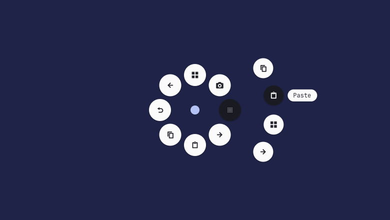
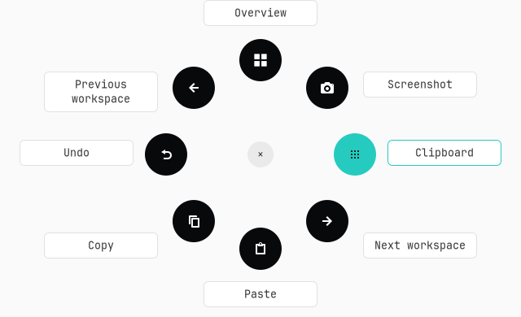

# Actions Ring and Smart Actions

These features are Linux implementations using the MX4's HID++ event stream and the local desktop. They do not execute Logitech's Windows/macOS application or connect to Options+ services. The supported desktop for this version is Niri on Wayland. Flow is intentionally deferred for a later Linux, Windows and macOS implementation.

## Use the ring

1. Open MX4 Linux and wait for your mouse settings to load.
2. Open **Actions Ring** and click **Enable** beside **Mouse integration**.
3. Hold the haptic panel, move the mouse towards a position and release. A short panel click instead leaves the ring open so you can point and click.
4. Change ring positions or open **Smart Actions** to create routines. Opening the editor keeps mouse integration enabled, and **Save changes** updates the active assignments.

To assign an installed app directly, choose **Add application** in **Actions Ring**, choose the position under **Replace the action at**, search for and select the app, then **Save changes**. The app opens only when you run that ring action. **Open application** is also available as a Smart Actions template and step.

The eight circular icon buttons run clockwise from the top. Labels appear beside the hovered or keyboard-selected button; the small center **×** closes the ring. Pointer clicks target the visible circles, so the gaps do not execute actions. Keys **1–8** select them; arrow keys move the selection, Enter confirms, and Escape returns from a group or closes the ring. Moving within the center dead zone does not select an action. A second panel click cancels an open ring. **Try the ring** uses the same interface but prints the chosen steps without executing them or playing feedback. The orbit traces into view, a selection marker travels between actions, and held movement shows its direction. Press feedback changes the icon and color while the circular hit area stays fixed. Motion follows the desktop animation preference and stops when the ring settles or closes; selecting an action never waits for an exit animation.

In **Edit actions → Actions Ring**, the live diagram shows the assignments with their labels. Click a diagram button to focus its assignment. Expand **Action groups (optional)** to choose up to six different existing routines for a position. Hovering or choosing that position opens a side menu; it does not run the parent routine. Select a child with the pointer, arrows and Enter, or keys **1–6**. When holding the panel, release over a grouped position to leave its submenu open for selection. The center **×** always cancels. Old configurations remain valid, and groups are optional.



The ring is a centered layer-shell overlay, not a cursor-position popup. It captures the original application before opening and restores that focus before executing an action. A vanished target stops the action. Shortcuts and text triggered while an MX4 configuration window is focused are refused; use the panel from the application you want to control.

Closing the settings window keeps enabled mouse integration running in the background by default. Reopening MX4 Linux presents the same window and controller. Application Settings lets you disable this behavior. **Disable** stops integration; **Quit** (Ctrl+Q) exits the application and restores the selected controls' previous diversion/raw-motion flags. Closing a window with integration disabled still exits normally. Background operation does not enable integration or add login autostart.

Integration never diverts primary left/right click or scrolling. On unplug or cancellation, synthetic release events cancel the ring instead of committing its selection. The listener's haptic commands and event reads share one retained handle; separate HID++ software IDs prevent replies being confused with one-shot setting requests or Solaar.

Default assignments are Overview, Screenshot, Terminal, Next workspace, Paste, Copy, Undo and Previous workspace. Niri commands use its public IPC. Other compositor support requires adapters; on unsupported layer-shell desktops the ring can appear as a normal window, and Niri actions will report an error.

## Create a Smart Action

Open **Smart Actions**. Choose an existing routine or create one from a shortcut, launch, text or multiple-step template. Give it a name, expand a step to edit its fields, and use **Add step** plus the move/remove controls to build the sequence. **Edit steps as JSON** exposes the same data for advanced editing; **Advanced routine settings** contains the action ID. An optional application condition requires an exact match with the focused Niri `app_id`. Use `niri msg --json focused-window` to inspect that ID. Editing and saving do not execute the routine.



Example steps:

```json
[
  {"type": "shortcut", "keys": ["CTRL", "C"]},
  {"type": "delay", "milliseconds": 150},
  {"type": "command", "argv": ["kitty"]},
  {"type": "delay", "milliseconds": 700},
  {"type": "text", "text": "Hello from MX4 Linux"}
]
```

The example copies from the original application, launches a terminal, waits for it to focus, and types text. Launch steps return after starting the application; a delay may be needed before interacting with a newly launched window. Niri steps use `{"type":"niri","action":"toggle-overview","args":[]}`. Commands are explicit argument arrays and are never implicitly passed through a shell.

The whole document is validated before **Save changes** or execution. Each routine may have up to 64 steps and 60 seconds of total configured delay; execution is bounded to two minutes. **Stop routine** on the Actions tab stops subsequent steps. Held shortcut keys are released on cancellation/errors. A running routine rejects repeated triggers rather than building an unbounded queue.

The native Wayland keyboard backend uses [wtype](https://github.com/atx/wtype), pinned to release 0.4 / commit `d71be3a7b3f93b534a2823fd68cabd7ac2a02359` in `scripts/setup-wtype.sh`. It supports common modifiers, letters, digits, function keys and navigation/media keys. Unicode text uses the virtual-keyboard protocol and preserves the clipboard. Unsupported Linux key codes fall back to evdev `/dev/uinput`; an optional `scripts/install-input-access.sh` grants active-seat access if needed. The normal Niri path requires no extra privileged setup. A failed native key injection is not replayed through a second backend.

Configuration is stored privately in `$XDG_CONFIG_HOME/mx4-linux/desktop.json`, normally `~/.config/mx4-linux/desktop.json`. Editing one routine preserves unfinished drafts in the editor until saved or explicitly discarded. Renaming an action updates ring/button references; deleting a referenced action requires reassignment.

## CLI and desktop shortcuts

```sh
.venv/bin/mx4-linux ring
.venv/bin/mx4-linux ring --preview
.venv/bin/mx4-linux actions list
.venv/bin/mx4-linux actions show copy
.venv/bin/mx4-linux actions run copy --dry-run
.venv/bin/mx4-linux actions show > desktop.json
.venv/bin/mx4-linux actions validate desktop.json
.venv/bin/mx4-linux actions import desktop.json
```

`actions run ID` executes the routine; `--dry-run` performs no command, input or focus query. The ring CLI works without enabling mouse diversion and can be assigned to a Niri key binding, for example:

```kdl
Mod+R { spawn "/absolute/path/to/mx4-linux/.venv/bin/mx4-linux" "ring"; }
```

No compositor configuration or login autostart is modified automatically. If importing config through the CLI while the GUI is running, disable and re-enable mouse integration to apply new hardware button assignments.

## Verification and remaining interactive checks

The physical MX Master 4 reached listener-ready with haptic-panel diversion and raw XY enabled, then stopped with the exact original reporting flags and mapping restored. [Hardware smoke record](https://github.com/Dijo-404/mx4-linux/blob/main/evidence/desktop-hardware-smoke.json). The GTK ring was opened and selected in preview mode, and native Ctrl+A / Unicode text insertion was tested against an isolated GTK entry. Tests also cover malformed packets, disconnect/cancellation, temporary flag restoration, focus checks, macro execution and session replacement.

No automated check simulates a physical panel press. Interactive confirmation remains for hold/release selection with the real mouse, haptic feedback during selection, and unplug/reconnect while holding. Bluetooth has not been exercised. See [validation notes](validation.md).

Implementation sources: [Solaar protocol research](linux-support-research.md), [GTK4 layer-shell API](https://wmww.github.io/gtk4-layer-shell/gtk4-layer-shell-GTK4-Layer-Shell.html), [layer-shell Python linking requirements](https://github.com/wmww/gtk4-layer-shell/blob/main/linking.md), and [Niri IPC](https://github.com/YaLTeR/niri/wiki/IPC).
