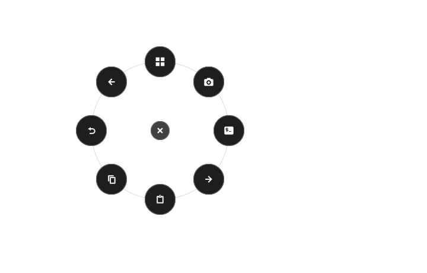

# Ring reconnect, click selection and pointer placement

Validated on 19 October 2026 in the local Niri/Wayland session.

Enabled integration keeps retrying the same mouse after disconnecting, including when unplugging prevented immediate cleanup. Recovery verifies the stable identity and restores previous reporting before replay or listener startup. Retry delays increase to a maximum of 30 seconds and continue until Disable or Quit; ownership conflicts still block automatic acquisition. The old reconnect preference no longer gates an already-enabled integration.

The physical trigger opens a latched ring on its first press. Release does not choose an action, even if it arrives during the asynchronous focus query. A second press cancels. Existing application-profile acknowledgement and original-target checks remain in place. The bottom instruction bar is removed; action labels and keyboard accessibility guidance remain.

On supported layer-shell desktops, brief transparent surfaces locate the stationary pointer on its output without moving it or taking keyboard focus. The real popup then covers that output with a transparent input surface and moves only its faces, in output-local logical coordinates. Placement clamps the visible action circles, not the transparent layout padding, so the ring stays beside the pointer in corners and respects configured ring scale. Timeout after 100 ms falls back to centered placement. Non-layer-shell desktops retain compositor-controlled positioning. Every location surface is destroyed on success, timeout, cancellation or setup failure.

## Verification

- Final Python regression suite: 1,205 tests and 32 subtests passed (79.54 seconds).
- Native ring and placement regressions: 70 passed, including output-edge clamping, logical scaling, cleanup across multiple outputs, partial setup failure, repeated opening and late callbacks after dismissal.
- Six Node launcher tests, Ruff, whitespace checks and native GTK smoke passed.
- Independent review found no blocking defects; 255 independent scoped tests passed before the final cleanup regressions were added.
- Production application exited through its normal Quit/restoration path and restarted with the updated source. Its previously enabled same-mouse integration recovered and reached listener-ready. Saved user configuration hashes matched before and after.

The native pointer proof used a 1440 × 900 logical output at device scale 2. With the stationary pointer at (325.133, 633.793), popup margins were (55, 414) and the actual GDK pointer position inside the ring was (270.133, 219.793), within 0.25 logical pixels of its (270, 220) center. Pointer lookup plus ring construction took 72 ms. Preview callbacks executed no actions. The capture contains only the ring widget tree.

## Corners and right-click dismissal

A right click on the background or center dot closes the ring without choosing anything. A right click on an action circle, or on a group child, leaves the ring open and does not select it. Right clicks anywhere on the output close the ring, including areas beyond the old 780 × 440 popup. Groups opened at an edge rotate their arc inward, keeping spacing and distance from the root circles.

- Python regression suite: 1,243 tests and 32 subtests passed. Ruff and whitespace checks passed.
- Native corner check on both live outputs (1440 × 900 at device scale 2 and 2560 × 1440 at scale 1), at ring scales 75, 100 and 150 with the pointer in each corner: 24 cases. Each ring center sat exactly 96 × scale logical pixels from both edges. All 192 root-face and 1,152 group-child checks were fully on screen, hit their own face at the allocated center and kept their label on screen. Preview callbacks selected nothing.
- The production application quit through its normal Quit/restoration path, relaunched with the updated source and reached listener-ready with the same mouse.

No physical unplug/replug gesture or user routine was performed in this pass. Outage/recovery scenarios are covered by mocked regression tests; the live listener restart establishes startup and same-unit recovery, not physical reconnect acceptance. Bluetooth and other compositors were not validated. Existing GTK deprecation warnings and an unavailable desktop accessibility bus were observed during checks.
