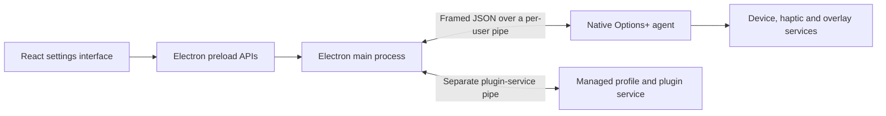

# Installed Windows Options+: MX Master 4 investigation

Inspected 2026-10-18 through user-authorized SSH access. This pass acquired the
installed Options+ resources and native agent, then examined the additional
`Logi` and `LogiDownloadAssistant` installations requested by the user.
The installation declares agent version **2.9.994631**; the UI executable's
file version is **2.9.4631.0**.

The main result is a concrete map of the interface/agent boundary and recovered
schemas for haptics, force sensing, profiles and Actions Ring. The MX4-specific
encoded device resources, native handler bodies and device packet translation
remain unresolved. This is useful interoperability evidence, not a complete
reimplementation specification or physical-device validation.

| Installed directory | Established role | MX4 relevance |
| --- | --- | --- |
| `LogiOptionsPlus` | Settings interface, native device agent and overlay/service protocols. | Haptic/force capabilities, device resources and ring integration. |
| `Logi/LogiPluginService` | Managed plugin/action/profile service with radial-menu message types. | The ring's virtual-device and action-assignment model. |
| `LogiDownloadAssistant` | Native software recommendation/download/install assistant with Demalu SDK headers. | Device discovery and software delivery; no MX4 ring/force implementation established. |

## Target identity and acquisition

| Installed artifact | Bytes | SHA-256 |
| --- | ---: | --- |
| `resources/app.asar` | 61,845,517 | `8689e5fda6047864abe1c9f89486c03f7e1a4f960cbf0267c2f362f88d303a27` |
| `logioptionsplus_agent.exe` | 68,391,064 | `0d7149a8ded851cb492f75e3b78306cc68b60dc623b2341267db17bb15b1f03c` |
| `data/devices.json` | 3,680 | `177d14be6b3394ec8a87510dad2f7f5cb3b13d593b51cb572a6a39e7b330e929` |

These three digests were calculated on Windows and matched the acquired local
bytes. Installed processes observed by name/path included the agent, appbroker,
updater and LogiPluginService. Seeing a process does not establish which
features it exercised. The [remote Options+ installation inventory](../evidence/windows-optionsplus/installation-inventory.json)
contains 229 files; only relevant artifacts were copied for analysis.

Original proprietary artifacts and the full REA export are retained locally in
the ignored `evidence/artifacts/windows-optionsplus/` directory. The repository
retains selected metadata, schemas, analysis receipts and our inspection tools.
Credentials and user settings databases are not part of that retained evidence.

## How the application is divided

The ASAR manifest declares `main.js` as its entry point and lists React, Redux
and Electron dependencies. Its Electron development dependency is `39.1.2`;
this is a manifest declaration, not a measurement of the running runtime.

Direct static reads of `main.js` and `preload.bundle.js` establish this intended
communication path:



The final service grouping is an architectural inference from the recovered
protocols and native strings. No complete native call graph was recovered.

On Windows the main process constructs a pipe name from
`logitech_kiros_agent-` followed by the MD5 of `os.userInfo().username`. It uses
Node's `net.createConnection`; the macOS branch constructs an analogous `/tmp/`
socket path. The backend launcher names
`%PROGRAMFILES%/LogiOptionsPlus/logioptionsplus_agent.exe`. Separate pipe
connections exist for voice and LogiPluginService. [L1]

The sender's frame layout is:

```text
uint32_le(JSON byte length + 12)
uint32_be(4)
ASCII "json"
uint32_be(JSON byte length)
UTF-8 JSON
```

The renderer constructs a request with a monotonically increasing string
`msg_id`, `verb`, `path`, and an optional `payload`. The embedded native
`logi/common_protocol/message.proto` independently describes those fields,
plus `origin` and `result`; its payload is `google.protobuf.Any`. Its verb enum
contains GET, SET, BROADCAST, REMOVE, SUBSCRIBE, UNSUBSCRIBE and OPTIONS. These
are application-service messages, not mouse HID++ packets. [L1, L2, L3]

## Haptics and force sensing

The recovered `haptics.proto` describes a richer software model than a single
play-waveform setting:

| Schema | Observed fields / meaning |
| --- | --- |
| `HapticSettings` | Global enable, event-source settings, feedback level, power saving. |
| `HapticCapabilities` | Default feedback level, all-levels/specific-levels format, supported levels and waveforms, optional stop/status/info features. |
| `Config.HapticDeviceConfig` | Event-source support, event-to-waveform mappings, event blacklists and plugin-event support. |
| `PlayWaveFormRequest` | Waveform ID and an option to enable waveform-info events. |
| `PlayWaveFormResponse` | Received-and-started versus received-and-ignored status. |
| `WaveformRunningStatus` | No waveform, software waveform, device waveform, or unknown/error. |

The UI contains GET calls for `/haptics/%s/status` and
`/haptics/%s/event_sources`, with a device ID substituted into the path.
Playback and stop routes are also present; neither was called. Localization
explicitly names MX Master 4 in macro-feedback messages and describes a
separate Windows OS haptics integration. Presence in the package does not prove
that integration is enabled on this machine. [L1, L2, L3]

The native enum names waveforms 0–14 consistently with the independent Solaar
definitions already used here. It also has additional breathing/timer waveform entries
at IDs 15–19 and `NONE=255`. Those application-level enum entries do not prove
that the MX4 firmware accepts every ID. In particular, this enum does not
establish a replacement for Solaar's device-discovered whisper-collision
`0x1B`. Keep capability validation and do not copy the enum into the hardware
waveform allowlist. [L3]

`force_sensing.proto` describes per-button minimum, default, maximum and high
force values, whether changing force/layers is supported, the number of
thresholds, and `default_l2_force`. Settings carry `button_index` and
`current_force`; a separate layer configuration has `layer1_enabled` and
`layer2_enabled`. These are field definitions. They supply no numerical MX4
thresholds, physical force units, hysteresis or HID++ packing. [L3]

The UI does reveal how its four force choices are selected: LIGHT uses
`minForce`, MEDIUM uses `defaultForce`, HARD uses `highForce`, and FIRM uses
`maxForce` from the first button's capability record. It stores the chosen
value in `card.forceSensingSettings.buttonsForceSensingSettings[0].currentForce`.
Waveform IDs and intensity values likewise come from capabilities. The UI's
low-battery inhibition predicate checks battery percentage **at or below 10%**
with global haptics and power saving both enabled; this is UI logic, not proof
of a firmware power policy. [L2]

## Actions Ring, profiles and actions

The native `radial_menu.proto` describes:

- Show requests with PRESS/RELEASE state, a slot ID and button name.
- Overlay resize requests and an integer percentage scale.
- SHOWN, DISMISSED, ACTION_EXECUTED, HOVERED and
  ANALOG_VALUE_LIMIT_REACHED events.

These establish the intended overlay-service interface. They do not determine
the selection deadzone, movement gain, hover timing, group geometry, release
commit policy or the waveform assigned to each interaction. Native strings
and schemas alone must not be presented as observed mouse behavior. [L3]

The Creative Console bundle does recover the **editor's** geometry: eight root
positions at `index * 45 - 90` degrees, folder children centered around their
parent in 22.5-degree steps, and 300-ms folder transitions. Its folder changes
carry device, application, profile, mode, workspace, page and control context.
These are editor/profile semantics, not proof of the live popup's dimensions
or input timing. Drag-and-drop hover timers in that editor must not be copied
as live ring selection delays. [L2]

Native agent diagnostics name a DirectX11 radial-menu implementation,
`Radial_Menu_window`, and separate button press/release callbacks that describe
show/select commands. Together with LPS nested press/rotate assignments, this
supports a split between the editor, native overlay, and action/plugin
execution. Those diagnostics are string evidence, not decompiled bodies or
an observed event sequence. See [native findings](../evidence/windows-optionsplus/native-findings.md).

The plaintext defaults distinguish generic control assignments from
device-specific slot assignments and provide per-application overrides. For
example, middle/back/forward control IDs `82/83/86` have global assignments;
Photoshop overrides them with pan/undo/redo. Gesture and mode-shift IDs
`195/196` also occur. No haptic control ID `416` occurs in the parseable
default JSON. Several slot examples explicitly identify MX Master 3, so they
must not be attributed to MX4. Profile resolution precedence remains a
separate code/runtime question. [L1]

## Device resources and what remains encoded

Of 88 JSON-named files in `data`, 35 parse as JSON and 53 are opaque envelopes.
The plaintext initial device database has 118 entries. Fifty-two numbered
device updates and one card-preset update use the opaque format. Searches of
the parseable JSON did not identify B042/B048 or a named MX Master 4 profile.
This is a bounded search, not evidence that the installation lacks MX4 support.

`devices.json` references `devices/devices_0000065.json` at `/files/52`. That
48,750-byte file has magic `21 05 21 20`, a 130-byte JSON metadata header
containing `key-id` and `file-sha`, and a declared 48,608-byte opaque payload.
The envelope SHA-256 is
`43e8a914df0c965b3f898687cea64f93b311c55f646a4050505bb3059b61eed7`.
Its filename does not identify its contained model. The payload transform and
the meaning/integrity of its declared `file-sha` were not recovered; encryption
or a particular algorithm is not established. [L1]

The frontend's device list/resource API and the native `Resource`/model
messages provide concrete entry points for a later supported runtime query or
native resource-reader analysis. They do not themselves decode these payloads.

## Additional installations

### `Logi/LogiPluginService`

Seven inspected assemblies declare version **6.4.2.3414**, target **.NET 10**,
and contain inspectable CIL. Their static method bodies provide stronger
evidence than names alone. The verified call path from
`GenericPlugin.ShowRadialMenuDynamicAction.SendShowDeviceEvent` reaches
`RadialMenuMessageHandler.OnShowDevice`, then sends event objects through
`LoupedeckMessageHandler.SendEvent`. Show/hide overlay methods dispatch events
to connected clients. These methods do not identify the drawing client.

The managed assignment model has separate press and rotate actions, recursive
nested controls, display/active images, colors, adjustment values and scale.
Page changes rebuild an assignment cache. Button and encoder handlers resolve
profile actions; mouse-enter/leave handling selects or clears a temporary
contextual-wheel adjustment. Windows adapters call process activation, volume
mute and keyboard-event abstractions. These explain how the ring connects to
actions beyond its visible circles. [L6]

`LogiConnection.dll` reaches bodyless native client/server/read/write shims.
`PluginApi.dll` dynamically loads a platform implementation. Its generic
text/icon overlay class is not established as the interactive ring renderer.
`NativeApi.dll` is itself a managed assembly despite its name. The separate
native `LogiPluginServiceExt.exe` has IPC and contextual-display/Loupedeck
hardware diagnostics; image-output names there do not establish desktop ring
rendering. See [managed findings](../evidence/windows-optionsplus/plugin-service-findings.md)
and [support-binary metadata](../evidence/windows-optionsplus/plugin-service-native.json).

### Additional installation: `LogiDownloadAssistant`

The additional [installation summaries](../evidence/windows-optionsplus/additional-installation-summary.json)
record 1,462 files under `Logi` and 30 under `LogiDownloadAssistant`. The latter's
main executable is version **2.0.1020.0**, 19,199,488 bytes, SHA-256
`885e25d7c1c6d6fde6476260ffd1b0d30fc14cf5894d7912a6330646dd5a1078`.
Its hash was independently matched between Windows and the local copy.

Its diagnostics describe device/model discovery, per-model manifest retrieval,
skipping already-installed software or disabled reminders, notification prompts,
software downloads and installer handoff. These support its recommendation and
delivery role; no native function bodies or actual downloads were observed.

The shipped Demalu C++ headers directly declare update checks, downloads,
installation, abort, payload authentication, ZIP unpacking and progress
callbacks. Request fields select application/product/OS and carry public-key
and download/execute options. Header contracts do not prove runtime enforcement.
Bounded ASCII/UTF-16 searches found no MX4/B042/B048 identity or specific
Actions Ring/19B0/19C0 implementation names. Generic HID++/devio and Windows
haptics type names do occur, so a claim that the helper contains no device or
haptics code would overstate the search. No embedded URL or manifest was
fetched. See [the downloader findings](../evidence/windows-optionsplus/download-assistant-findings.md)
and [metadata/offsets](../evidence/windows-optionsplus/download-assistant.json).

## Implications for this Linux project

1. Retain Solaar's runtime device discovery, waveform validation and feature
   index lookup. The vendor's software schemas are not replacement HID++ specs.
2. The haptic UI can eventually distinguish global strength, event-source
   feedback and power saving where actual device support is established.
3. Treat two-layer panel behavior as a capability to investigate. Do not invent
   physical thresholds from protobuf field names.
4. Automatic application profiles and slot/card assignments are a larger model
   than the current routine-level app-ID condition.
5. The current ring motion gain `0.45`, deadzone `24`, clamp radius `155` and
   hover waveform `0` remain Linux design choices. This pass does not validate
   them as Logitech constants.

No application implementation was changed during this investigation.

## Coverage and evidence

| Investigation question | Status |
| --- | --- |
| Acquire the installed app/agent and verify target identity | Answered for the three hashed artifacts above. |
| Explain the UI/agent transport and request envelope | Answered statically; live exchange unverified. |
| Recover haptic/force/radial/profile data structures | Answered for the retained embedded descriptors; native implementation unresolved. |
| Recover MX4-specific device defaults and physical thresholds | Unresolved inside opaque resources. |
| Establish ring geometry, selection timing and feedback mapping | Partially answered at API level; exact native behavior unresolved. |
| Recover HID++ command construction and reconnect replay | Unresolved; requires native handler analysis or a device capture. |
| Verify actual haptics, panel behavior, Bluetooth and reconnect | Not performed; existing hardware checklist remains open. |

A bounded read-only probe attempted to send GET `/routes` to the existing
agent pipe. The connection closed and the first write failed with
`Pipe is broken`; **no response or device configuration was obtained**. The
reason for closure is unknown. The agent/appbroker processes were still present
afterward. No playback, settings write, application restart or hardware change
was requested by the investigation.

REA inventory verified the ASAR contents and reported no integrity
contradictions. Its selected JavaScript analysis covered `package.json`,
`main.js` and `preload.bundle.js`; fourteen other inventoried source/resource
files were outside that AST analysis. The semantic graph is partial and hit
unknown-retention limits. Separate bounded static reads covered selected UI
logic. No Ghidra/native decompiler was configured, so no native pseudocode or
complete handler call graph is claimed.

| Ref | Retained evidence | Identity / scope |
| --- | --- | --- |
| R1 | [REA inventory summary](../evidence/windows-optionsplus/rea-inventory-summary.json) | Inspection parent `ev_8c52d74d0aa49a71a1963250277bc2b548cf7702141cc41970957afa5483ecb4`; manifest `agm_b6334cdef61efc70c52f3455aa713a90deaa527a2681d198c60813971a62e683`. |
| R2 | [REA JavaScript summary](../evidence/windows-optionsplus/rea-javascript-summary.json) | Analysis parent `ev_84a5f1de796ee68e46a7b9803d4f857baa94d667250ab7d2d34112546bac0739`; selected-source, partial static coverage. |
| L1 | [Resource observations](../evidence/windows-optionsplus/resources.json) | Ordinary local parsing, file hashes, JSON pointers and exact source-byte observations; not REA Evidence. |
| L2 | [UI findings](../evidence/windows-optionsplus/ui-findings.md) | Bounded static string decoding and selected logic; original-byte references and limitations. |
| L3 | [Agent schemas](../evidence/windows-optionsplus/agent-schemas.json) | Embedded protobuf descriptors with source ranges/digests; schema presence, not executed handlers. |
| L4 | [Additional artifact identities](../evidence/windows-optionsplus/additional-artifact-identities.json) | Nine additional Windows/local hash matches across the plugin service and downloader. |
| L5 | [Download Assistant observations](../evidence/windows-optionsplus/download-assistant.json) | Full copied-file inventory, binary/header offsets and bounded searches; PE-resource REA ID `ev_f571da4b02c2552eff684e66d96b1647792ec0330892aa15527d3c39dbae5d84`. |
| L6 | [Plugin-service findings](../evidence/windows-optionsplus/plugin-service-findings.md) | Focused managed call edges: service `ev_936c5ddb4d9620d6b5ed30c2c0c3a13fe6acec30c578d49a1211450d6730e3da`; GenericPlugin `ev_f19df3ab8c61cc108742be8003f56a598bfb10cfbbc9b108272ac958e5fc58c4`. |

The REA extraction record is
`ev_51ce51e01e93166fdabd4322e7fa96fdf586a7c6209a909dd67f5ca1905dfc75`.
The complete seven-record REA bundle is retained with the ignored raw artifacts.
The later 55-record session export, including managed inspection and the
downloader resource evidence, is retained at
`evidence/artifacts/windows-logi-plugin-service/rea-managed-evidence.json`.

To repeat the local metadata inspection, supply the acquired artifact directory
containing `app.asar`, `logioptionsplus_agent.exe` and the copied `data` tree:

```sh
python evidence/windows-optionsplus/inspect_resources.py /path/to/artifacts --output /tmp/resources.json
python evidence/windows-optionsplus/inspect_agent.py /path/to/artifacts/logioptionsplus_agent.exe --output /tmp/agent-schemas.json
```

Both inspectors parse local bytes without executing the vendor application.
The original [installer analysis](installer-analysis.md) remains a separate
target with its own digest and narrower evidence boundary.
